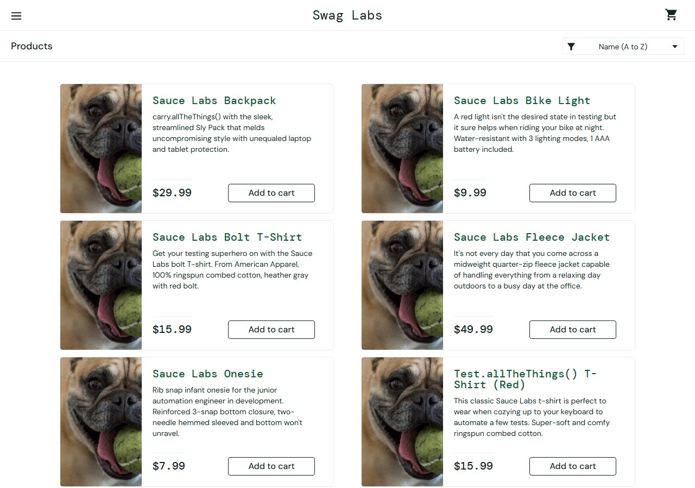
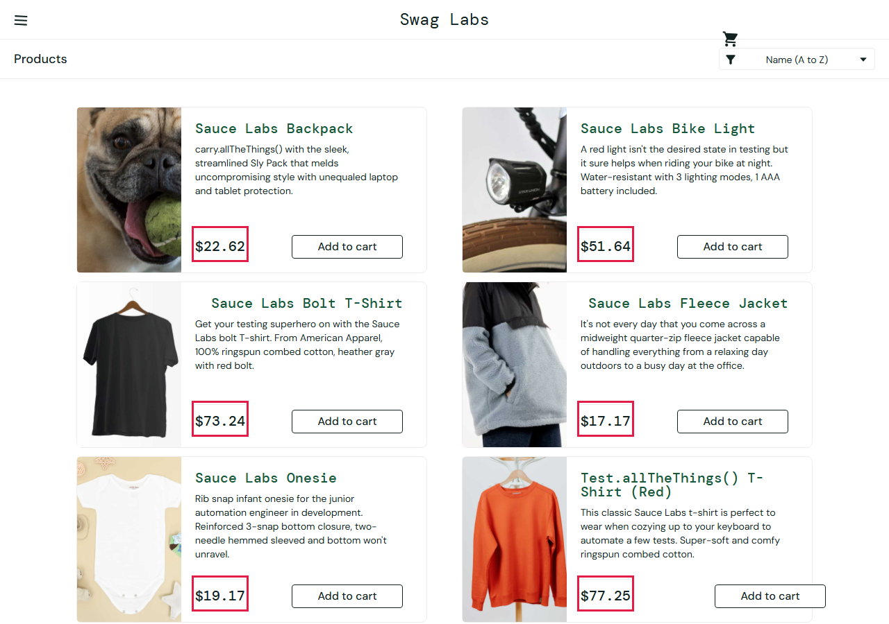
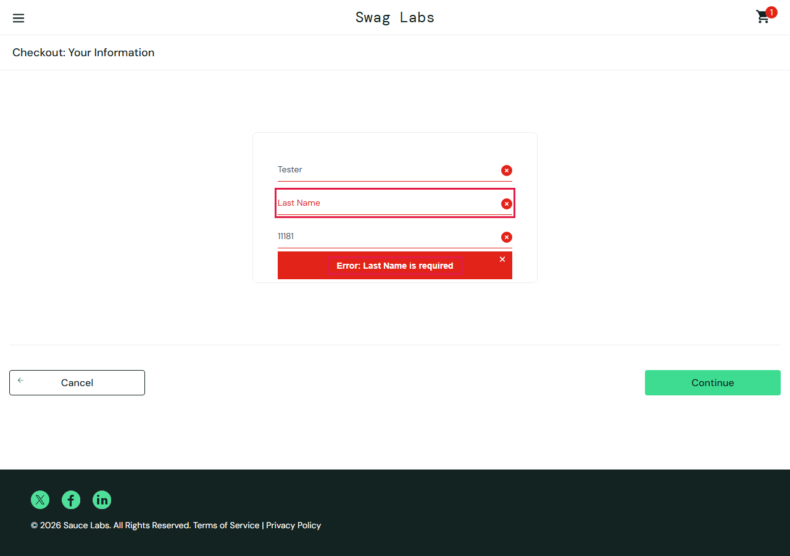
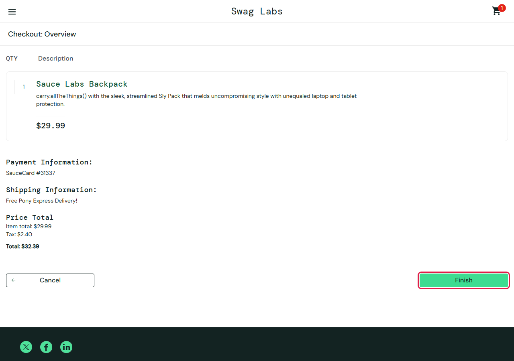

# Manual testing case study: Swag Labs web shop

[](https://github.com/3mmario/manual-testing-case-study/actions/workflows/verify-defects.yml)

A complete, end-to-end manual / SIT test effort on https://www.saucedemo.com, a public demo shop built for testing practice. It shows how I plan, design, execute and report testing, with every result backed by a real run and a screenshot.

**By Ammar Alkhatib**, QA Engineer (ISTQB CTFL 4.0.1), Amman, Jordan. [LinkedIn](https://www.linkedin.com/in/ammaral) | [GitHub](https://github.com/3mmario)

## Result at a glance

| | |
|---|---|
| Test cases executed | **41** (29 passed, 12 failed) |
| Defects reported | **8**: 3 Critical, 4 Major, 1 Minor |
| Extra findings (need a product decision) | 4 |
| Requirements traced | 13, all covered |
| Exploratory sessions | 2 |
| Core purchase path for `standard_user` | Passed |
| Recommendation | Release for `standard_user`; block the other profiles until BUG-03, BUG-05 and BUG-06 are fixed |

Counts are generated from the real run results by script, not typed by hand ([summary report](docs/06-test-summary-report.md)).

## What this shows

- **Planning:** a test plan with scope, out of scope, approach, entry and exit criteria, environment and risks.
- **Risk-based thinking:** likelihood x impact scoring that decides where to test first, checked against the defects found afterwards.
- **Test design techniques, used explicitly:** equivalence partitioning and boundary values (checkout form), a decision table (login), state transition with a diagram (cart and checkout), error guessing.
- **Clean test cases:** minimal and complete, grouped happy path, business rules, negative / edge. Delivered as Markdown, CSV and Excel.
- **Traceability:** every requirement maps to cases, every failure maps to a defect or finding.
- **Honest execution:** a Playwright helper drives the browser, records the actual result and saves a screenshot per case. Pass or fail is computed, never edited.
- **Good bug reports:** same template each time, severity separate from priority, steps, expected vs actual, impact, and a screenshot with the defect outlined in red.
- **Judgment:** requirement gaps are written up as findings for a product owner instead of being inflated into bugs.
- **Reproducibility in CI:** a GitHub Actions workflow re-verifies every reported defect headless on each push and uploads the screenshots.

## Deliverables

| # | Artifact | Link |
|---|---|---|
| 1 | Test plan | [docs/01-test-plan.md](docs/01-test-plan.md) |
| 2 | Risk-based analysis and matrix | [docs/02-risk-analysis.md](docs/02-risk-analysis.md) |
| 3 | Test design (EP/BVA, decision table, state transition) | [docs/03-test-design.md](docs/03-test-design.md) |
| 4 | Test cases | [Markdown](test-cases/test-cases.md), [CSV](test-cases/test-cases.csv), [XLSX](test-cases/test-cases.xlsx) |
| 5 | Requirements traceability matrix | [docs/04-traceability-matrix.md](docs/04-traceability-matrix.md) |
| 6 | Execution results and evidence | [test-cases/results.json](test-cases/results.json), [docs/evidence/](docs/evidence/) |
| 7 | Bug reports (8) and findings | [bug-reports/](bug-reports/README.md) |
| 8 | Exploratory charters and session notes | [docs/05-exploratory-testing.md](docs/05-exploratory-testing.md) |
| 9 | Test summary report | [docs/06-test-summary-report.md](docs/06-test-summary-report.md) |
| 10 | CI workflow | [.github/workflows/verify-defects.yml](.github/workflows/verify-defects.yml) |

## Defects

| ID | Title | Severity |
|---|---|---|
| [BUG-03](bug-reports/BUG-03.md) | problem_user: Last Name field does not accept input, checkout is blocked | Critical |
| [BUG-05](bug-reports/BUG-05.md) | error_user: order cannot be completed, Finish does nothing | Critical |
| [BUG-06](bug-reports/BUG-06.md) | visual_user: product prices differ from the catalogue and change on every login | Critical |
| [BUG-01](bug-reports/BUG-01.md) | problem_user: all six products show the same placeholder image | Major |
| [BUG-02](bug-reports/BUG-02.md) | problem_user: sort dropdown has no effect | Major |
| [BUG-04](bug-reports/BUG-04.md) | problem_user: third Add to cart is ignored and Remove does nothing | Major |
| [BUG-08](bug-reports/BUG-08.md) | performance_glitch_user: login takes about 5 to 7 seconds | Major |
| [BUG-07](bug-reports/BUG-07.md) | visual_user: Add to cart button of the last product is misaligned | Minor |

## Evidence samples

| BUG-01: same image for every product | BUG-06: wrong prices for visual_user |
|---|---|
|  |  |

| BUG-03: Last Name rejects input | BUG-05: Finish does nothing |
|---|---|
|  |  |

## How to run

Requires Node.js 20 or newer.

```bash
npm install
npx playwright install chromium

npm run run:cases     # executes the 41 cases, screenshots to docs/evidence/cases/, writes test-cases/results.json
npm run build:docs    # rebuilds CSV, Markdown, XLSX, traceability matrix and summary report from the results
npm run verify:bugs   # re-reproduces each defect, refreshes docs/evidence/BUG-xx.png, exits 1 if one is gone
npm run all           # all three in order
```

Add `--headed` to a script to watch the browser (for example `node scripts/run-cases.js --headed`).

The target is a live public site, so a run reflects the site as it is today. If the Sauce Labs team changes the faulty profiles, `verify:bugs` fails and the affected report needs a retest.

## Project structure

```
docs/                 test plan, risk analysis, test design, traceability, exploratory notes, summary
docs/evidence/        screenshots: BUG-xx, F-xx and one per test case (cases/)
test-cases/           cases (md, csv, xlsx), requirements.json, results.json
bug-reports/          one file per defect, README with findings, bugs.json / findings.json (data)
scripts/              lib.js (helpers), cases.js (case definitions + executable steps), run-cases.js,
                      verify-bugs.js, build-docs.js
.github/workflows/    verify-defects.yml
```

## Notes on honesty

- The site has no specification. Requirements are derived from observed behaviour and normal e-commerce expectations, and say so. The 2 second login target is an assumption.
- The faulty behaviour of `problem_user`, `error_user`, `visual_user` and `performance_glitch_user` is intentional on this demo site. The reports treat it as production behaviour to practise the process.
- Scope is Chromium desktop, one tester, one site. No claim of full coverage is made.

## License

MIT, see [LICENSE](LICENSE).
