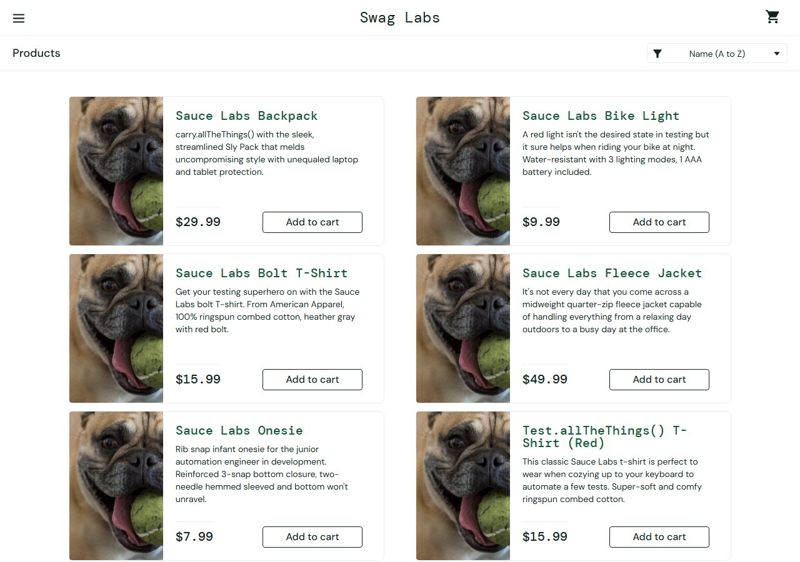

# BUG-01: problem_user: all six products show the same placeholder image

| Field | Value |
|---|---|
| **Severity** | Major |
| **Priority** | High |
| **Status** | Open (reproduced in each run; re-checked on every push by CI) |
| **Reported** | 2026-11-27 by Ammar Alkhatib |
| **Environment** | https://www.saucedemo.com, Windows 11, Chromium (Playwright 1.65.1), viewport 1280x900 |
| **User profile** | `problem_user` |
| **Found by** | [TC-033](../test-cases/test-cases.md) |

## Steps to reproduce

1. Open https://www.saucedemo.com
2. Log in as `problem_user` / `secret_sauce`
3. Look at the images of all six products

## Expected result

Each product shows its own photo (backpack, bike light, T-shirt, jacket, onesie, red T-shirt), as for standard_user.

## Actual result

All six tiles show the same image, a dog with a tennis ball (`/assets/sl-404-*.jpg`). Product names and prices are correct.

## Impact

Shoppers cannot tell products apart visually; strongly reduces conversion.

## Evidence

The defect is outlined in red. Reproduction is automated in [`scripts/verify-bugs.js`](../scripts/verify-bugs.js).

## Notes

Reproducible every time. The image file name suggests a fallback "404" asset is being served for every product. Compare TC-002 (passes for standard_user).
