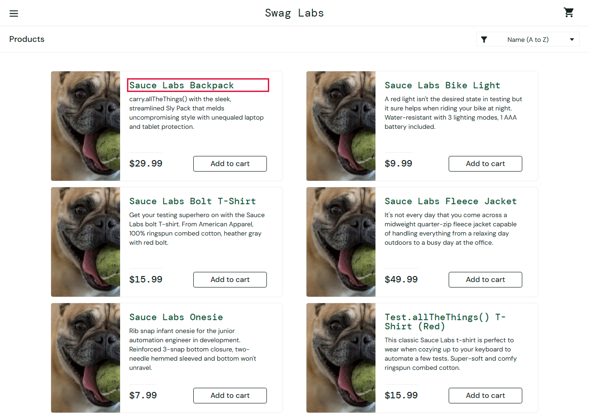

# BUG-02: problem_user: sort dropdown has no effect on the product list

| Field | Value |
|---|---|
| **Severity** | Major |
| **Priority** | Medium |
| **Status** | Open (reproduced in each run; re-checked on every push by CI) |
| **Reported** | 2026-11-27 by Ammar Alkhatib |
| **Environment** | https://www.saucedemo.com, Windows 11, Chromium (Playwright 1.65.1), viewport 1280x900 |
| **User profile** | `problem_user` |
| **Found by** | [TC-034](../test-cases/test-cases.md) |

## Steps to reproduce

1. Log in as `problem_user`
2. Open the sort dropdown and choose "Name (Z to A)"
3. Read the order of the product names

## Expected result

List is reordered Z to A: Test.allTheThings() T-Shirt first, Sauce Labs Backpack last.

## Actual result

The dropdown shows "Name (Z to A)" but the list stays in A to Z order, Sauce Labs Backpack first. Price sorting also does not order the prices.

## Impact

Users cannot find products by price or name. The control gives no error, so the failure is silent.

## Evidence

The defect is outlined in red. Reproduction is automated in [`scripts/verify-bugs.js`](../scripts/verify-bugs.js).

## Notes

Price low to high was also checked manually: prices come out as $29.99, $9.99, $15.99, $49.99, $7.99, $15.99, which is the unsorted order.
