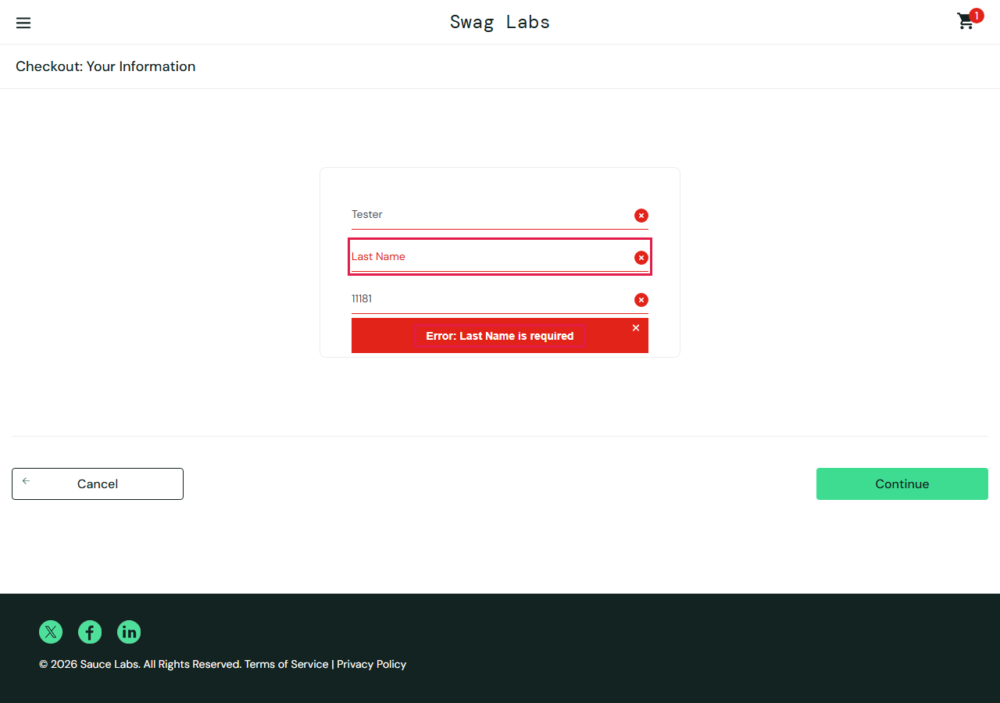

# BUG-03: problem_user: Last Name field does not accept input, checkout is blocked

| Field | Value |
|---|---|
| **Severity** | Critical |
| **Priority** | High |
| **Status** | Open (reproduced in each run; re-checked on every push by CI) |
| **Reported** | 2026-11-27 by Ammar Alkhatib |
| **Environment** | https://www.saucedemo.com, Windows 11, Chromium (Playwright 1.65.1), viewport 1280x900 |
| **User profile** | `problem_user` |
| **Found by** | [TC-035](../test-cases/test-cases.md) |

## Steps to reproduce

1. Log in as `problem_user`
2. Add "Sauce Labs Backpack" to the cart, open the cart and click Checkout
3. Type `Ammar` in First Name, `Tester` in Last Name, `11181` in Postal Code
4. Click Continue

## Expected result

All three fields keep what was typed and Continue opens the order overview.

## Actual result

The text typed into Last Name does not stay in that field: Last Name stays empty and the First Name field ends up containing "Tester". Continue shows "Error: Last Name is required" and the user cannot proceed.

## Impact

Checkout is impossible, so no order can be placed. A blocker for this user profile.

## Evidence

The defect is outlined in red. Reproduction is automated in [`scripts/verify-bugs.js`](../scripts/verify-bugs.js).

## Notes

Second symptom seen in the screenshot: the value in the first field is overwritten by the last name text. Reproduced with typed input and with Playwright `fill`. The same flow passes for standard_user (TC-008).
