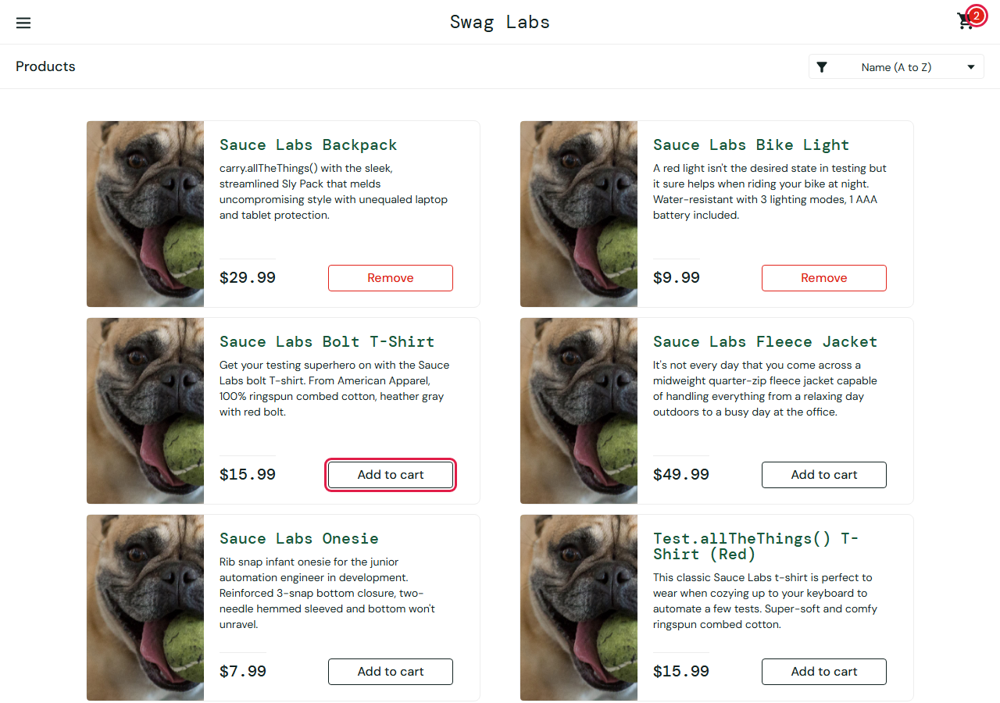

# BUG-04: problem_user: third Add to cart is ignored and Remove does nothing

| Field | Value |
|---|---|
| **Severity** | Major |
| **Priority** | High |
| **Status** | Open (reproduced in each run; re-checked on every push by CI) |
| **Reported** | 2026-11-27 by Ammar Alkhatib |
| **Environment** | https://www.saucedemo.com, Windows 11, Chromium (Playwright 1.65.1), viewport 1280x900 |
| **User profile** | `problem_user` |
| **Found by** | [TC-036](../test-cases/test-cases.md) |

## Steps to reproduce

1. Log in as `problem_user`
2. Click Add to cart on the first three products (Backpack, Bike Light, Bolt T-Shirt)
3. Check the cart badge
4. Click Remove on the Backpack and check the badge again

## Expected result

Badge shows 3 after adding; after removing it shows 2 and the Backpack button returns to "Add to cart".

## Actual result

Only two products are added (badge 2); the third Add to cart click does nothing. Clicking Remove on the Backpack does nothing: the button stays "Remove" and the badge stays 2.

## Impact

The cart does not match what the user chose, and wrongly added items cannot be removed.

## Evidence

The defect is outlined in red. Reproduction is automated in [`scripts/verify-bugs.js`](../scripts/verify-bugs.js).

## Notes

In the screenshot the third product (highlighted) still offers "Add to cart" after being clicked. Behaviour was identical in 3 runs.
