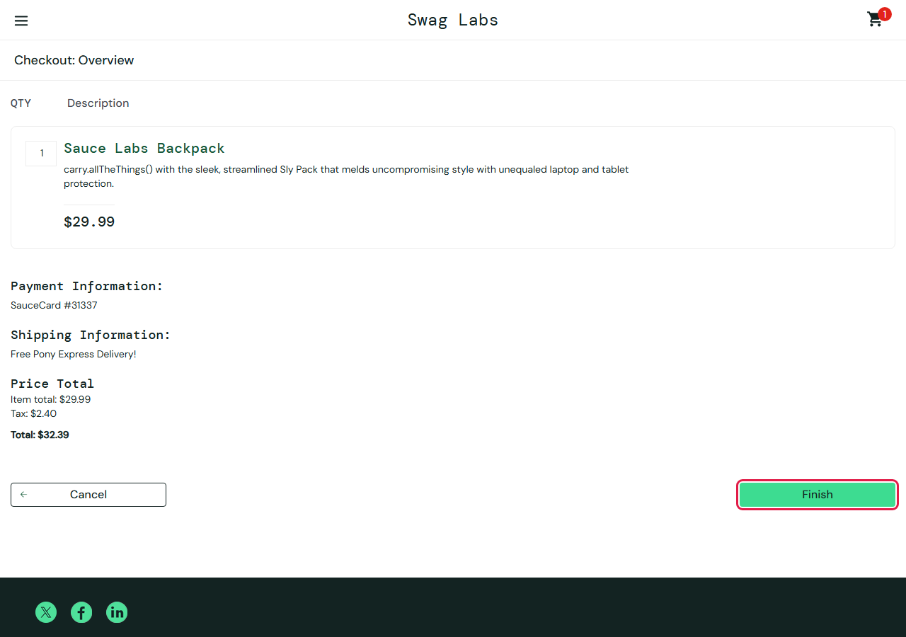

# BUG-05: error_user: order cannot be completed, Finish does nothing and Last Name is silently dropped

| Field | Value |
|---|---|
| **Severity** | Critical |
| **Priority** | High |
| **Status** | Open (reproduced in each run; re-checked on every push by CI) |
| **Reported** | 2026-11-27 by Ammar Alkhatib |
| **Environment** | https://www.saucedemo.com, Windows 11, Chromium (Playwright 1.65.1), viewport 1280x900 |
| **User profile** | `error_user` |
| **Found by** | [TC-037](../test-cases/test-cases.md) |

## Steps to reproduce

1. Log in as `error_user`
2. Add "Sauce Labs Backpack", open cart, click Checkout
3. Enter `Ammar` / `Tester` / `11181` and click Continue
4. On the overview click Finish

## Expected result

Order is placed and "Thank you for your order!" is shown.

## Actual result

Continue opens the overview even though Last Name does not keep its value (no validation error is shown). Clicking Finish does nothing: the page stays on `/checkout-step-two.html` and the cart badge still shows 1.

## Impact

No purchase can be completed and the user gets no error message explaining why. Revenue-blocking.

## Evidence

The defect is outlined in red. Reproduction is automated in [`scripts/verify-bugs.js`](../scripts/verify-bugs.js).

## Notes

Also observed for error_user (not filed separately): selecting any sort option raises a browser alert "Sorting is broken! This error has been reported to Backtrace." and the third product cannot be added to the cart. Covered in exploratory session 2.
