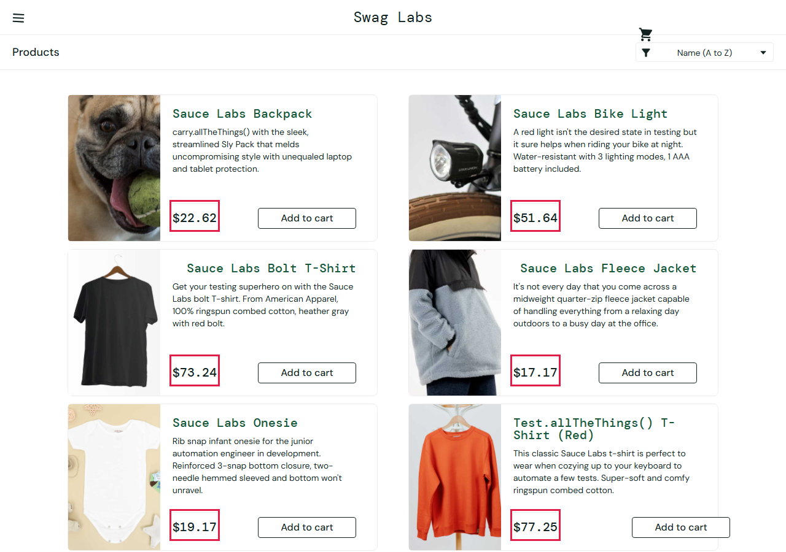

# BUG-06: visual_user: product prices differ from the catalogue and change on every login

| Field | Value |
|---|---|
| **Severity** | Critical |
| **Priority** | High |
| **Status** | Open (reproduced in each run; re-checked on every push by CI) |
| **Reported** | 2026-11-27 by Ammar Alkhatib |
| **Environment** | https://www.saucedemo.com, Windows 11, Chromium (Playwright 1.65.1), viewport 1280x900 |
| **User profile** | `visual_user` |
| **Found by** | [TC-038](../test-cases/test-cases.md) |

## Steps to reproduce

1. Log in as `standard_user` and note the prices ($29.99, $9.99, $15.99, $49.99, $7.99, $15.99)
2. Log out, then log in as `visual_user`
3. Compare the six prices

## Expected result

Prices are identical for every user: they are the catalogue prices.

## Actual result

visual_user sees different prices for the same products (for example $20.51, $93.07, $2.35, $70.72, $35.20, $60.27 in one run) and the values change on every login.

## Impact

Customers are quoted wrong, unstable prices. Legal and financial risk.

## Evidence

The defect is outlined in red. Reproduction is automated in [`scripts/verify-bugs.js`](../scripts/verify-bugs.js).

## Notes

Not a random-looking rounding error: the values differ in every run, so a fixed expected value cannot be asserted for visual_user; the test compares against standard_user instead (TC-038).
