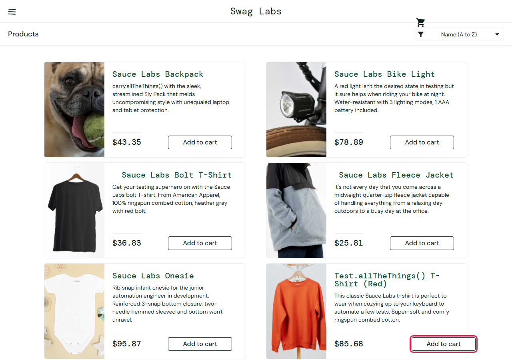

# BUG-07: visual_user: Add to cart button of the last product is misaligned

| Field | Value |
|---|---|
| **Severity** | Minor |
| **Priority** | Low |
| **Status** | Open (reproduced in each run; re-checked on every push by CI) |
| **Reported** | 2026-11-27 by Ammar Alkhatib |
| **Environment** | https://www.saucedemo.com, Windows 11, Chromium (Playwright 1.65.1), viewport 1280x900 |
| **User profile** | `visual_user` |
| **Found by** | [TC-039](../test-cases/test-cases.md) |

## Steps to reproduce

1. Open the site in a 1280x900 browser window
2. Log in as `visual_user`
3. Compare the horizontal position of the Add to cart buttons

## Expected result

The button of the last product lines up with the buttons of the other right-hand tile (x = 975 px).

## Actual result

The Add to cart button of "Test.allTheThings() T-Shirt (Red)" is shifted to the right (x = 1029 px, 54 px off). Other tiles are aligned.

## Impact

Cosmetic. Looks unprofessional but the button still works.

## Evidence

The defect is outlined in red. Reproduction is automated in [`scripts/verify-bugs.js`](../scripts/verify-bugs.js).

## Notes

The same screenshot also shows the cart icon floating above its normal position and some product titles shifted sideways; these were not measured, only seen. Measured with `getBoundingClientRect` and checked by eye in the screenshot (red outline). In one early exploratory run the first product image was also a placeholder for visual_user; it did not recur, so it is not part of this report.

