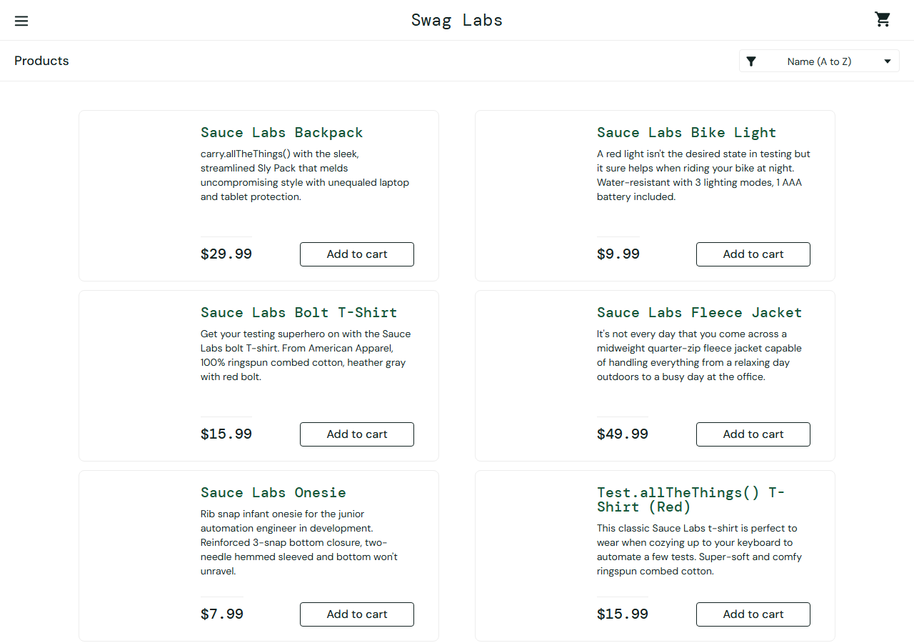

# BUG-08: performance_glitch_user: login takes about 5 to 7 seconds

| Field | Value |
|---|---|
| **Severity** | Major |
| **Priority** | Medium |
| **Status** | Open (reproduced in each run; re-checked on every push by CI) |
| **Reported** | 2026-11-27 by Ammar Alkhatib |
| **Environment** | https://www.saucedemo.com, Windows 11, Chromium (Playwright 1.65.1), viewport 1280x900 |
| **User profile** | `performance_glitch_user` |
| **Found by** | [TC-040](../test-cases/test-cases.md) |

## Steps to reproduce

1. Open https://www.saucedemo.com
2. Enter `performance_glitch_user` / `secret_sauce`
3. Click Login and measure the time until the product list is shown

## Expected result

Product list is visible within 2 seconds (assumed target).

## Actual result

The products page opens empty and the list only appears after about 5 to 7 seconds (measured 5.2 to 7.2 s across six runs; standard_user takes under 1 s).

## Impact

Slow login frustrates users and can cause abandonment; there is no loading indicator.

## Evidence

The defect is outlined in red. Reproduction is automated in [`scripts/verify-bugs.js`](../scripts/verify-bugs.js).

## Notes

The screenshot is taken 1.5 s after clicking Login: the header is shown but there are no products. Timings are from a corporate network and vary by run.
