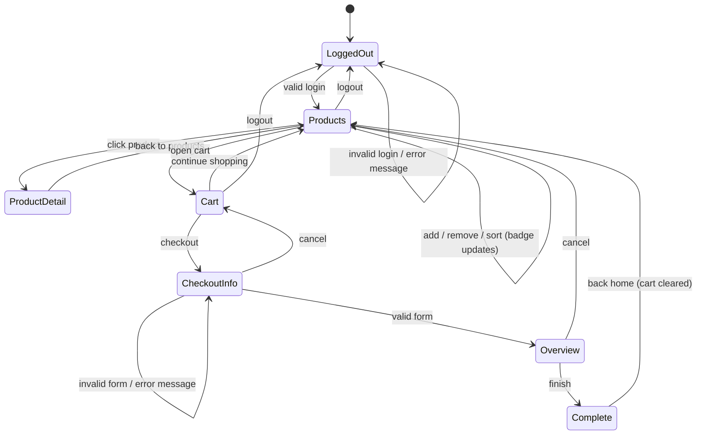

# Test design

Four techniques are used where they fit best. Each section ends with the cases it produced, so nothing is designed and then forgotten.

1. Equivalence partitioning and boundary value analysis for the checkout form
2. Decision table for login
3. State transition testing for the cart and checkout flow
4. Error guessing (inputs that often break forms)

## 1. Equivalence partitioning and boundary values: checkout step one

Fields: First Name, Last Name, Postal Code. There is no written rule for formats or length. The only rule the UI states is "required". So the partitions are about presence and about what a sensible customer might type.

### Partitions per field

| Field | Valid partitions | Invalid partitions |
|---|---|---|
| First Name | V1: letters, normal length ("Ammar") | I1: empty; I2: whitespace only |
| Last Name | V1: letters, normal length ("Tester") | I1: empty |
| Postal Code | V1: digits ("11181"); V2: alphanumeric with a space ("SW1A 1AA") | I1: empty |

Only one invalid value is combined with otherwise valid fields, so a failure points at one cause (single-fault assumption).

### Boundary values

Length is the only numeric dimension.

| Boundary | Value | Reason | Case |
|---|---|---|---|
| Minimum | 0 characters | Just below the lower boundary: must be rejected | TC-025, TC-026, TC-027 |
| Minimum | 1 character | On the lower boundary: must be accepted | TC-029 |
| Whitespace edge | 3 spaces | Non-empty string, empty meaning | TC-030 |
| Maximum | 300 characters | No upper limit is documented, so test a clearly large value and check the flow survives | TC-031 |

Maximum boundary result: the site accepts 300 characters, i.e. it enforces no limit. That is recorded as an observation, because no requirement forbids it.

### Combination rule: which error wins?

When more than one field is empty, only one message appears. TC-028 (all empty) checks the precedence: First Name, then Last Name, then Postal Code. Only the first case in that order is needed because the others are covered by TC-025 to TC-027.

### Resulting cases

TC-025, TC-026, TC-027, TC-028, TC-029, TC-030, TC-031, TC-032.

## 2. Decision table: login

Conditions: is the username filled, is the password filled, does the username exist, is the password correct, is the account locked. Impossible combinations are removed (for example "password correct" when the username does not exist).

| Rule | Username filled | Password filled | Username exists | Password correct | Locked | Expected outcome | Case |
|---|---|---|---|---|---|---|---|
| R1 | Y | Y | Y | Y | N | Login, products page | TC-001 |
| R2 | Y | Y | Y | Y | Y | "Sorry, this user has been locked out." | TC-016 |
| R3 | Y | Y | Y | N | - | "Username and password do not match any user in this service" | TC-017 |
| R4 | Y | Y | N | - | - | Same generic message as R3 (no user enumeration) | TC-018 |
| R5 | N | Y | - | - | - | "Username is required" | TC-019 |
| R6 | Y | N | Y | - | - | "Password is required" | TC-020 |
| R7 | N | N | - | - | - | "Username is required" (first field wins) | TC-021 |

Extra rows from the same table, near the equivalence boundary of "username exists":

| Input | Why | Expected | Case |
|---|---|---|---|
| `Standard_User` | Case sensitivity | Rejected as R4 | TC-022 |
| ` standard_user` (leading space) | Trimming | Rejected as R4 | TC-023 |
| `' OR '1'='1' --` | Injection string | Rejected as R4, no error page | TC-024 |

Profiles `problem_user`, `error_user`, `visual_user` and `performance_glitch_user` fall under R1 (they log in) and are then tested for what they do after login (TC-033 to TC-041).

## 3. State transition: cart and checkout

### Transition table

Valid transitions are exercised by the happy-path and business-rule cases. Invalid transitions (events that should not be possible in a state) are the interesting part.

| From | Event | To | Case |
|---|---|---|---|
| LoggedOut | valid login | Products | TC-001 |
| LoggedOut | invalid login | LoggedOut | TC-017 to TC-024 |
| LoggedOut | open `/inventory.html` directly (invalid) | LoggedOut + message | TC-014 |
| Products | add, remove | Products | TC-006, TC-007 |
| Products | open detail, go back | Products, cart kept | TC-011 |
| Products | reset app state | Products, cart empty | TC-013 |
| Cart | cancel from checkout | Cart, items kept | TC-012 |
| Cart (empty) | checkout (should be invalid) | CheckoutInfo reached | TC-015, finding F-01 |
| CheckoutInfo | invalid form | CheckoutInfo | TC-025 to TC-028, TC-030 |
| CheckoutInfo | valid form | Overview | TC-029, TC-032 |
| Overview | finish | Complete, cart cleared | TC-008 |
| Complete | browser back (invalid) | explored, see [session 1](05-exploratory-testing.md) | exploratory |
| Any | logout, then protected URL | LoggedOut + message | TC-009 |

0-switch coverage: every transition in the diagram is covered except "Overview -> Products (cancel)" and "Complete -> Products", which were judged low risk. The main path was also tested as one sequence (TC-008).

## 4. Error guessing

Ideas from experience of what breaks e-commerce flows, and where they ended up:

| Guess | Where |
|---|---|
| Whitespace-only required fields | TC-030 (found F-02) |
| Checkout with nothing in the cart | TC-015 (found F-01) |
| Browser back after finishing an order | Exploratory session 1 |
| Cart state after logout and re-login | Exploratory session 1 |
| Double-click on Add to cart | Exploratory session 1 |
| Non-existent product id in the URL | Exploratory session 1 |
| Injection string in a text field | TC-024 |
| Same flow for each user profile | TC-033 to TC-041 |
